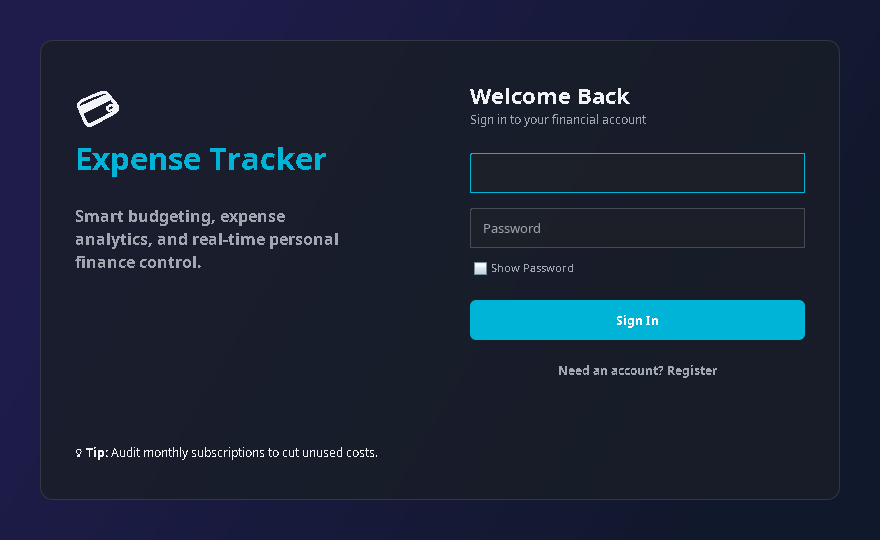
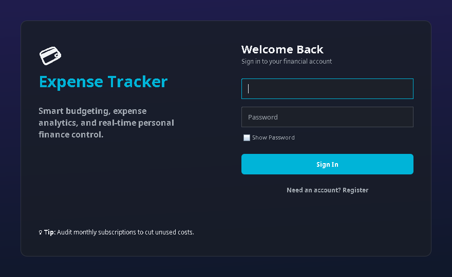
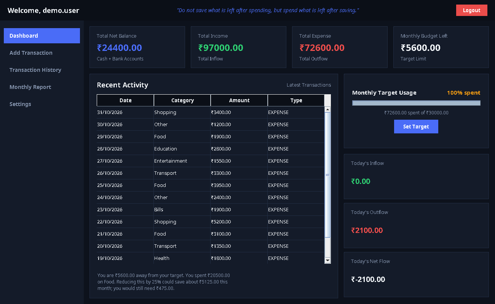
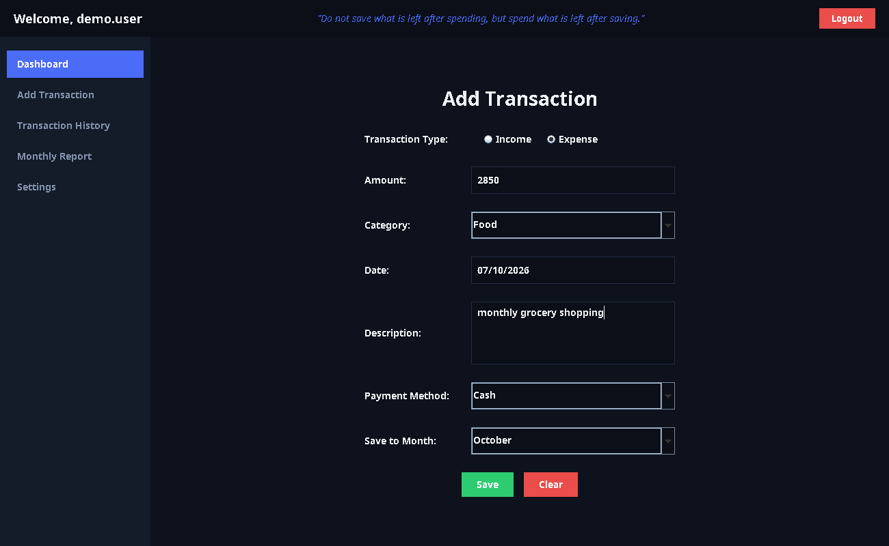
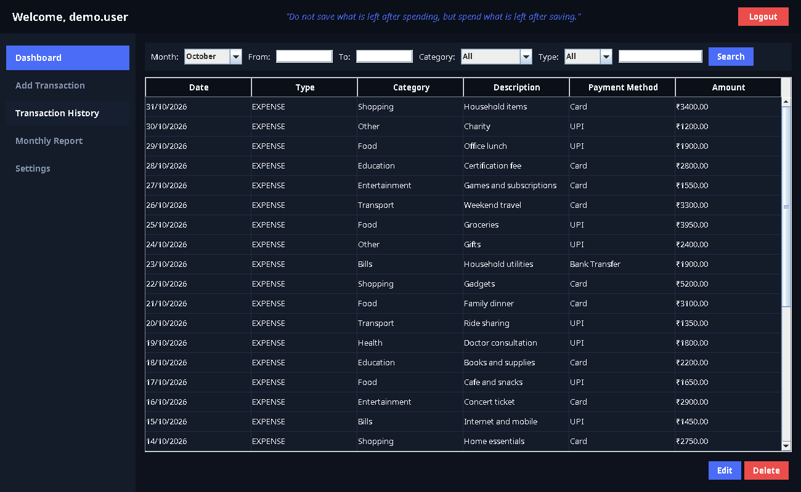
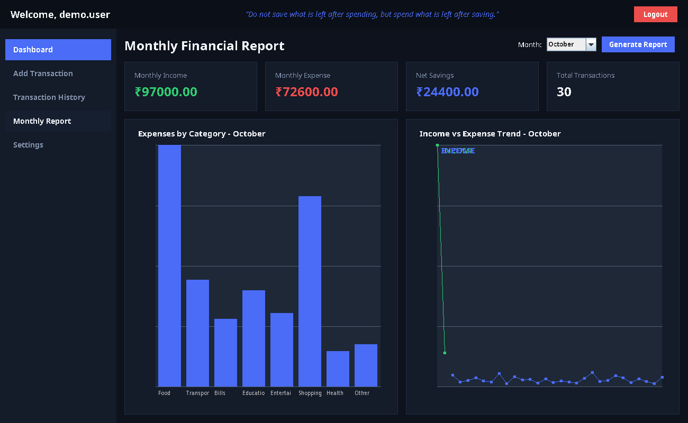
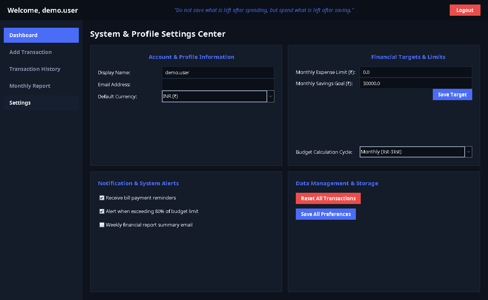

# Expense Tracker

A Java-based desktop Expense Tracker for recording income and expenses, reviewing transaction history, analyzing monthly activity with charts, and maintaining a monthly savings target. The application uses a graphical desktop interface and local file-based persistence.

## Problem Statement

Managing personal income and expenses manually can make it difficult to track spending, monitor financial activity, understand spending patterns, maintain transaction history, and work toward savings goals.

The application provides a desktop-based solution for recording and managing financial transactions, viewing spending information, analyzing monthly activity, and maintaining a savings target.

## Project Overview

Expense Tracker is a Java desktop application with a Swing graphical user interface. It provides login and registration, a dashboard, transaction management, transaction history, monthly reports with charts, a savings target, and basic rule-based spending advice.

The application uses the existing `LocalStore` implementation for local persistence and does not require MySQL, SQL, JDBC, or an external database.

## Objectives

- Record income and expenses
- Maintain transaction history
- View financial activity
- Analyze spending using charts
- Track monthly savings goals
- Provide basic rule-based spending advice
- Store data locally

## Features

- User registration
- User login
- Dashboard with income, expenses, balance, and monthly target information
- Add income and expense transactions
- Transaction history with month, date, category, type, and search filters
- Monthly spending information
- Monthly savings target
- Smart Dashboard Advice based on the application's rule-based spending analysis
- Reports and charts using JFreeChart
- Local persistent storage
- Original desktop UI

The Smart Dashboard Advice is **not AI**. It is implemented as basic rule-based spending advice based on the application's transaction data.

## Technologies Used

- Java 17+
- Java Swing
- Maven
- JFreeChart 1.5.4
- Java serialization and local file storage

## System / Application Workflow

```text
Login / Register
      ↓
   Dashboard
      ↓
Add / View Transactions
      ↓
Transaction History
      ↓
Monthly Reports / Charts
      ↓
Savings Target / Spending Advice
```

## Data Storage

The application does not require MySQL, SQL, JDBC, or an external database.

Data is stored locally using the existing `LocalStore` implementation.

**Storage location:**

```text
~/.expense-tracker/data.ser
```

The local store persists:

- User accounts
- Password hashes
- Transactions
- Monthly savings target

All application screens use the same `LocalStore`, so login/register, dashboard, transactions, history, reports, and settings remain connected to the same local data.

## Project Structure

```text
ExpenseTracker/
├── README.md
├── .gitignore
├── pom.xml
├── .vscode/
│   └── launch.json
├── screenshots/
│   ├── login.png
│   ├── register.png
│   ├── dashboard.png
│   ├── add-transaction.png
│   ├── transactions.png
│   ├── reports.png
│   └── savings.png
└── src/
    └── main/
        └── java/
            ├── DBUtil.java
            ├── DashboardUI2.java
            ├── LocalStore.java
            ├── LoginSystem.java
            ├── Transaction.java
            └── UserAccount.java
```

## Requirements

- JDK 17 or newer
- Maven

## How to Run

From the project root:

```bash
mvn clean compile
```

To launch the application through the configured Maven exec plugin:

```bash
mvn exec:java
```

The configured entry point is `LoginSystem`.

### VS Code

Open the `ExpenseTracker` folder in VS Code and run the **Run Expense Tracker** configuration from `.vscode/launch.json`, or run `LoginSystem.java` directly using the Java extension.

## Screenshots

The screenshots below were captured from the Expense Tracker interface using fictional demonstration data. They show populated screens rather than empty application states.

### Login



### Registration



### Dashboard



### Add Transaction



### Transaction History



### Monthly Reports and Charts



### Savings Target and Spending Advice



## Limitations / Notes

- Data is stored locally on the machine and is not synchronized to a cloud service.
- The application does not use MySQL, SQL, JDBC, or an external database.
- Demonstration screenshots use fictional sample financial data.
- The Smart Dashboard Advice is rule-based spending advice, not artificial intelligence or machine learning.
- The application is intended as a desktop expense-management project and does not provide professional financial advice.

## License

This project is provided for educational/project demonstration purposes.
